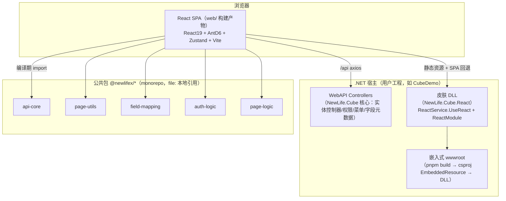
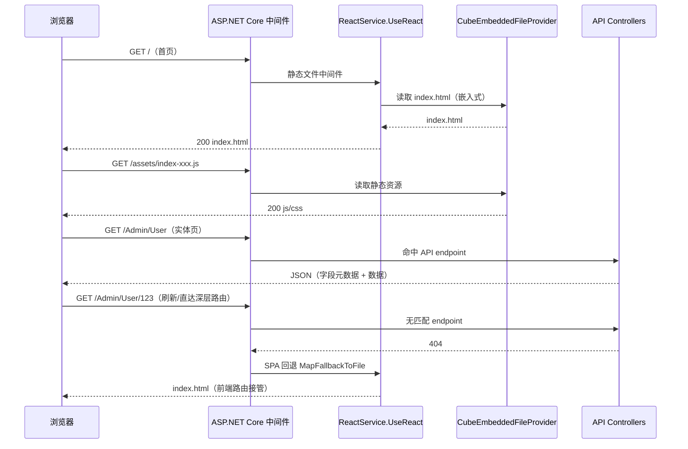

# NewLife.Cube.React 架构设计

> 版本：v2.1 | 日期：2026-10-24
> 需求对应：[需求文档](需求文档.md) | 功能追踪：[功能清单](功能清单.md)

---

## 1. 整体架构

### 1.1 定位

`NewLife.Cube.React` 是第三代魔方（API 版 `NewLife.Cube`）的 React 前端皮肤 NuGet 包，独立仓库管理。用户引用 `NewLife.Cube` + `NewLife.Cube.React` 两个包，`dotnet run` 后浏览器打开即有完整管理后台。

### 1.2 分层总览



### 1.3 层间关系与核心原则

- **后端（NewLife.Cube）**：负责认证、权限、菜单、字段元数据与 CRUD API——一切以字段元数据（`meta`）为驱动源
- **皮肤（本仓库 .NET 侧）**：只做"接入"——注册嵌入式静态资源 + SPA 回退，不承载业务
- **前端（web/）**：纯展示与交互，从 `@newlifex/*` 公共包读状态、调方法，`fieldControl.ts` 是字段→控件映射的单一真理源
- **公共包**：框架无关核心（axios 封装、认证/列表/表单业务逻辑、字段映射规则），Vue/React 双端共享

## 2. SKIN — 皮肤集成（.NET）

### 2.1 职责

| 职责 | 说明 |
|------|------|
| 嵌入式静态资源 | `pnpm build` 产物 `wwwroot/` 经 csproj `<EmbeddedResource>` 嵌入 DLL |
| 静态文件服务 | `UseReact` 用 `CubeEmbeddedFileProvider` 提供嵌入式文件，与主机 `WebRootFileProvider` 组合 |
| SPA 回退 | 未匹配 endpoint 回退 `index.html`，支持 Browser History |
| 模块注册 | `ReactModule : IModule` 供 `AddCube()` 自动发现 |
| NuGet 打包 | 版本/图标/描述/符号包配置齐全，依赖 `NewLife.Cube` NuGet |

### 2.2 核心组件

| 组件 | 所在工程 | 说明 |
|------|----------|------|
| `ReactService` | NewLife.Cube.React | `UseReact(env)` 扩展方法：装配文件提供器 + SPA 回退 |
| `ReactModule` | NewLife.Cube.React | `IModule` 实现，Module 模式注册静态文件 |
| `CubeEmbeddedFileProvider` | NewLife.Cube | 嵌入式资源文件提供器（`NewLife.Cube.React.wwwroot` 前缀） |
| `NewLife.Cube.React.csproj` | NewLife.Cube.React | `EmbeddedResource Include="wwwroot\**\*"` + `FrameworkReference Microsoft.AspNetCore.App` + `PackageReference NewLife.Cube` |
| `CubeDemo` | 示例工程 | `AddCube()` + `UseCube()` + `UseReact()` 完整调用链演示 |

### 2.3 关键流程



### 2.4 打包与嵌入

```
web/（pnpm build）──► ../wwwroot/（Vite outDir）
                            │
                            ▼
NewLife.Cube.React.csproj  <EmbeddedResource Include="wwwroot\**\*">
                            │
                            ▼
NewLife.Cube.React.dll ──► NuGet 包（NewLife.Cube.React.{version}.nupkg）
```

- `vite.config.ts`：`build.outDir = '../wwwroot'`、`emptyOutDir: true`
- `.NET 侧`：csproj 嵌入 `wwwroot\**\*`；`ReactService.UseReact()` 注册嵌入式静态文件 + SPA 回退
- 部署只需 `NewLife.Cube.React.dll` + `NewLife.Cube.dll`，无物理 wwwroot 文件依赖

## 3. 公共包引用策略（关键决策）

### 3.1 当前方案：npm 单包 `@newlifex/cube`（beta dist-tag）

| 项 | 内容 |
|----|------|
| 依赖声明 | `web/package.json`：`"@newlifex/cube": "beta"`（跟随 npm dist-tag；`pnpm-lock.yaml` 锁定实际版本，CI `--frozen-lockfile` 不漂移） |
| 包结构 | 上游 5 个前端公共包已合并为单包 `@newlifex/cube`（提交 `c4df6b51`）：主入口为框架无关核心，`@newlifex/cube/zustand` 为 React 适配器（`pinia`/`vue`/`zustand` 均为可选 peer） |
| 版本演进 | 上游 master 每次包变更由 CI 发布 `0.1.0-beta.<时间戳>`（tag → latest）；本仓库升级用 `pnpm update @newlifex/cube` |
| 本地联调 | 改上游源码 → `../NewLife.Cube` 执行 `pnpm --filter @newlifex/cube build` → 本仓库 `pnpm link ../NewLife.Cube/packages/cube`；结束移除链接回到发布版 |
| 前置条件 | Node.js 24 + pnpm 9 + npm registry 访问；**不再**需要检出兄弟仓库（CI 三步「检出 monorepo/软链/构建公共包」已删除） |

**为什么可行**：上游已落地 npm 发布流水线（`publish-npm.yml`，OIDC Trusted Publishing），单包收敛了原先 5 包的内部 `workspace:*` 依赖；本仓库不再需要 `pnpm.overrides` 绕过，也不再受旧 `file:` 路径随上游目录调整而失效的影响。

### 3.2 历史方案（已废弃）：`file:` 本地引用 monorepo

| 项 | 内容 |
|----|------|
| 背景 | 5 个公共包各自以 `file:../../../NewLife.Cube/packages/*` 引用，配合 `pnpm.overrides` 绕过包内 `workspace:*` |
| 废弃原因 | 上游合并为 `packages/cube` 单包后旧目录删除，全新 `pnpm install` 直接失败；CI 需额外检出兄弟仓库并软链 |
| 迁移成本 | 仅 `package.json` + lockfile + import 路径（43 个文件）+ CI 步骤；行为不变（已用 422 单测 + 全量 E2E 验证） |

### 3.3 设计决策表

| 决策 | 选项 | 选择 | 理由 |
|------|------|------|------|
| 公共包引用方式 | A. 复制进仓库 / B. npm 版本引用 / C. `file:` 本地引用 / D. git 依赖 | B（单包 `@newlifex/cube`） | 上游已合并单包并发布 beta，`file:` 路径随之失效；npm 引用去掉兄弟仓库检出，CI 更简单，版本由 lockfile 固定 |
| 版本策略 | A. 精确版本 / B. `beta` dist-tag / C. caret 范围 | B | 上游以时间戳 beta 持续发布，跟 tag 便于及时取用修复；`pnpm-lock.yaml` 保证可复现，升级需显式 `pnpm update` |
| 工作台布局排序落点 | A. 共享 `mergeWidgetsWithLayout` / B. 皮肤保留分组排序 + 共享 loader | B | 共享实现按全局 `sort` 排序，与既有「KPI 组恒在内容部件前 + 未布局新卡按默认位插入」语义不同，直接替换会回退行为；采用共享 `createWidgetLayoutLoader`（读写/重置）与纯函数，排序语义留在皮肤 |
| 皮肤依赖 NewLife.Cube | A. ProjectReference / B. PackageReference | B | 独立仓库不与 monorepo 源码耦合，引 NuGet 即可 |
| ASP.NET Core 引用 | 依赖传递 vs 显式 `FrameworkReference` | 显式 | NuGet 传递不可靠（实测缺失），显式声明更稳 |
| CI 自动化 | 立即改造 vs 暂缓 | 已完成 | 三条 workflow 已落地；本次迁移进一步删除公共包检出步骤 |
| 页面呈现架构（`/meta`）适配落点 | A. React 皮肤内实现 / B. 共享包 `@newlifex/cube` 承载归一+权限+preset | B | 框架无关逻辑集中共享包，纯函数可单测，其它皮肤可复用（扩展梯 F4）；皮肤只做渲染 |
| 列偏好存储 | A. 后端 `Parameter(Page-React)` / B. 前端 `localStorage` | B | 呈现架构 §4.1 规则3 明确 `/meta` 不下发 `order`/`hidden`；保存即生效、无需重取元数据；跨设备同步让位给简单直接（后端持久化停用） |

## 4. 前端架构（web/）

### 4.1 数据流（公共包 + zustand）

```
后端 API（/Auth /Cube /{type}）
   │  axios（@newlifex/cube createCubeApi）
   ▼
stores/user（@newlifex/cube/zustand）──► 登录/登出/用户信息/菜单/权限
stores/menu（树↔扁平 + 激活）
views/list（@newlifex/cube/zustand createPageStore）──► 字段/数据/CRUD/分页
   │  resolveWidgets（@newlifex/cube）→ FieldMapping
   ▼
utils/fieldControl.ts（皮肤映射）→ ControlType/SearchControlType/ListControlType
   ▼
AntD 组件渲染（FieldControl 渲染器）
```

- **PageLogic（公共包）**：字段加载、列表查询、分页状态、CRUD、导入导出、图表——框架无关
- **fieldControl.ts（皮肤）**：把 FieldMapping 映射到皮肤控件类型——单一真理源，禁止在组件里写本地映射
- **组件只做渲染与交互**：不持有数据逻辑，从 store 读状态、调 store 方法

### 4.2 配置系统

```
优先级（低→高）：
  defaultConfig → env 配置（.env）→ window._CUBE_CONFIG_（运行时注入）
```

配置项：`base`（title/logo/footer）、`request`（baseUrl/timeout/附加头）、`auth`（tokenKey/登录页 URL）、`ui`（布局/主题）、`menu`（菜单字段映射）、`user`、`router`。

### 4.3 路由与菜单

- **静态路由表**（`router/index.tsx`）：`/`、`/login`、`/register`、`/activate`、`/forgot-password`、`/profile/security`、`/unauthorized`、`/loading`、`*` → `DefaultEntity`
- **DefaultEntity**：根据当前路径在菜单树中匹配，命中 → 渲染通用列表页，未命中 → 404
- **登录守卫**：RootLayout 检查 token，无 token 且路径需认证 → 重定向 `/login?r={redirect}`
- **特殊控制器页**：`views/db/DbPage`（/Admin/Db 数据库管理，非实体 CRUD）、`views/config/ConfigPage`（配置管理）

### 4.4 布局

```
RootLayout
  ├─ 未登录 → 渲染 Login 等公开页
  └─ 已登录 → 加载用户/菜单 → MainLayout
       MainLayout
       ├─ Sider：动态菜单（菜单树 → antd Menu，<lg 隐藏 + Drawer）
       ├─ Header：折叠按钮 + 单行面包屑 + NavbarSearch + 胶囊按钮(明暗/语言/通知) + 用户菜单
       ├─ Tabs：多标签页（stores/tabs，首页固定标签；仅剩首页时隐藏栏）
       ├─ Content：路由出口（内容容器 min(1440px,100%)）
       └─ Footer
```

### 4.5 字段控件映射（单一真理源）

符合魔方皮肤设计规范 §7.4/§8.3 的字段控件映射规则，皮肤内建三组映射：

| 映射 | 用途 | 输出类型 |
|------|------|----------|
| `resolveControl(field)` | 表单/编辑控件 | `ControlType` |
| `resolveSearchControl(field)` | 搜索控件 | `SearchControlType` |
| `resolveListControl(field)` | 列表单元格 | `ListControlType` |

**公共包分工**：`@newlifex/cube` 提供框架无关的 `resolveWidget`（本工程扩展其支持 lovCode/lovMulti、json/icon/richHtml/richMarkdown/time/enum/Guid 等），皮肤 `fieldControl.ts` 在其基础上映射到 AntD 控件。

**ItemType 能力（ITYPE 批次）**：`ItemType` 优先于 CLR 类型，`fieldControl.ts` 的 `ITEM_TYPE_TO_CONTROL` 是唯一入口，覆盖别名族（`email`/`phone`/`fax`/`secret`/`text`/`number`/`avatar`/`attachment`/`richtext`/`timespan`）、无后缀 `area`（等价 `area3`）、附件 `-` 后缀（`image-png` → accept `image/*,image/png`）与带参形式（`decimal(p,s)`、`TimeSpan:<格式>`、`Time:<格式>`、`time-<格式>`）。展示侧格式化集中在 `utils/numberFormat.ts`：`percent`（描述缩放词 + `scale-2` 位）/`money`/`decimal`/`TimeSpan`（按描述单位换算）/`Time`（Unix 秒）/`GMK`（1024 进制）。

### 4.6 主题系统

- antd `ConfigProvider` + `theme.token` 驱动：**单一主题 × 明暗**（defaultAlgorithm/darkAlgorithm）
- `stores/theme`：当前明暗，持久化 localStorage
- `App.tsx` 同步 `body[data-cube-mode]` 驱动全局 CSS 设计令牌（`--cube-*`）

### 4.7 公共组件清单

| 组件 | 规范依据 | 说明 |
|------|----------|------|
| LovSelect / LovSelectTable | §8 表单页 | LOV 值集选择（dataSource 或 lookup API） |
| Uploader | §8 表单页 | 附件/图片上传（attachments） |
| RichEditor / WangEditor | §8 表单页 | 富文本：html 用 wangEditor（`@wangeditor/editor` 核心包 + `WangEditor` React 封装）WYSIWYG，markdown 用文本域+预览 |
| JsonEditor / ColorPicker / IconSelector | §8 表单页 | 专用输入 |
| UserMenu / UserAvatar / LogoutButton | §3.2 用户区 | 用户区 |
| NavbarSearch | §5 菜单 | 菜单搜索 |
| LanguageSwitch / ModeSwitcher | §9 通用体验 | 顶部切换器（单一主题收敛后无 ThemeSwitcher） |
| TabsView | §6.2 多标签 | 多标签 |
| NotificationBell | §9 通用体验 | 通知铃铛：未读角标 + 下拉列表 + 标记已读；数据源见 §4.9 通知契约 |
| AiAssistant | §9 通用体验 | AI 助手（SSE + mermaid） |
| ModalContainer / ActionButton / TextOverflow / SearchBar | §7.2/§9 通用体验 | 辅助件 |

### 4.8 多语言本地化

前后端各自维护词表，运行时通过请求语言协同：

| 层 | 词表 | 语言选择 | 说明 |
|----|------|----------|------|
| 前端 UI | `src/i18n/*.ts` + `src/i18n/app/*.ts` | `?lang=` → localStorage → `.AspNet.Culture` → 浏览器 → 英文 | 语言清单 32 种；内置 11 种全量词典（约 302 KB 原始 / 74 KB gzip），下拉仅展示 11 种全量翻译语言（`fullyTranslatedLanguages`），其余语言统一回退英文；antd 语言包同步（非 11 种回退英文）；zh 变体、旧别名与区域映射对齐 Core；阿拉伯语/希伯来语/波斯语 RTL |
| 后端 API | `NewLife.Cube/Locales/*.yml` + `NewLife.Cube.React/Locales/*.yml` | `?lang=` → Cookie → `Accept-Language` → `NewLife.Setting.Language` | 英文为源文与兜底；Core 源生成器把 `Locales/*.yml` 编译进程序集，运行期合并 |

- **语言清单**：前端调用 `GET /api/Admin/React/Languages`（`ReactController.Languages`，匿名），后端基于 Core 的 `Localization.GetLanguages()` 返回语言键、当前语言下的显示名与自称，等价于 MVC 魔方基本设置页绑定的 `CubeLocalization.GetLanguageOptions()`；接口不可用时回退前端内置清单。
- **可选语言 = 后端清单 ∩ 前端全量翻译语言**（`fullyTranslatedLanguages`）：后端新增但前端未翻译的语言不出现；后端缺少的前端语言也不出现；顺序与显示名以后端为准。接口不可用时回退 11 种全量语言。
- **选择结果存哪里**：以服务端 `.AspNet.Culture` Cookie（`c=xx|uic=xx`）为准，`localStorage['cube-language']` 仅作前端镜像；`?lang=` 用于一次性链接与显式导航。**不写入用户 Parameter**：请求本地化发生在认证之前（登录页、静态资源、文件下载），Cookie/请求头能覆盖全链路；Parameter 需要认证后才可读取，且与全局 `NewLife.Setting.Language` 强制模式语义冲突。
- **自动与强制**：语言下拉含“跟随系统”（清空 Cookie/本地存储/URL 参数）；`NewLife.Setting.Language` 为受支持语言时后端强制该语言，前端读取 `forced` 后自动切换一次并刷新。
- **语言数量与包体积**：11 种全量语言静态打包，app+shell 词典实测约 302 KB 原始 / 74 KB gzip，约占当前前端总包（1.57 MB gzip）4.7%。主流产品语言数从 8（Ant Design Pro）到 19–29（Grafana/GitLab/Mattermost），再到 70–92（WordPress/Odoo）；20+ 时普遍按当前语言注入或懒加载，但其单个语言包常达 180–200 KB gzip，量级与本案 555 个 key 不同。当前选择静态 11 种以换取零加载抖动与实现简单；触发条件为可选语言 > 15 种或 i18n gzip > 150 KB（首屏 10%）时，改为按语言动态 import。21 种非全量语言不打包业务词典，统一回退英文；部分译文保留在 Git 历史，后续补齐后再晋升。
- **请求链路**：API 客户端统一附加 `Accept-Language`；切换语言时写入 `.AspNet.Culture`（`c=xx|uic=xx`）并同步 URL 中已有的 `lang` 参数。
- **数据刷新**：菜单、实体字段元数据、配置项与运行时消息都由服务端按请求语言返回，切换语言后刷新页面重新拉取，避免静态文案已切换而服务端数据仍是旧语言。
- **皮肤包文案**：`ReactSetting`、`ReactController` 与模块显示名以英文为源文，31 份译文 + `en.yml` 旧中文名映射落在 `NewLife.Cube.React/Locales/*.yml`；`DataField.Localize()` 按请求语言翻译设置项名称、说明与分类，下拉选项在 `OnGetFields` 中经 `L.T` 即时翻译。
- **前端兜底**：业务文案以中文原文为键，缺失译文时优先回退英文，英文也没有时回退中文原文；后端缺失译文时回退英文源文。

### 4.9 元数据装配与扩展梯（页面呈现架构）

后端 `NewLife.Cube` 以 `/meta` 自描述页面：`list`/`form`/`add`/`detail`/`search` 各输出完整字段数组（`add`/`detail` 与 `form` 相同则省略）；`toolbar` 声明自定义按钮；`setting` 只给页面能力与动作所需权限位（可安全缓存）。前端消费链：

```
{type}/meta
   │ api-core：expandPageMeta（form/add/detail → addForm/editForm/detail）
   ▼
page-logic：装配（pkField = entity.primaryKey、toolbar/ui 入状态、全量列 = meta.list、menuId+requiredPermissions 算有效权限）
   ▼
皮肤渲染：fieldControl 映射 → AntD 控件；preset 合并 → 列/表单呈现；渲染器注册表按 view 分派
```

**前端扩展梯**（对应呈现架构 §3，优先用低位手段，不足再升层）：

| 层 | 手段 | 落点 |
|----|------|------|
| F0 | 默认渲染 | `EntityListPage` + `FormDialog`（纯元数据驱动） |
| F1 | 页面呈现配置 preset | `PagePreset` 注册表（纯前端配置，不发请求、不改后端） |
| F1.5 | 全局渲染器注册 | `registerFieldRenderer`（列表单元格/搜索/表单三处按 `view` 分派） |
| F2 | 区块覆盖（混合页 M2） | `registerPageExtension`（自定义列/搜索区追加/工具栏追加/行操作/表单体替换） |
| F2.5 | 数据源替换 | `registerNoticeProvider`（通知未读/标记已读数据源，默认走 `/Cube/Notice/*` 约定端点） |
| F3 | 整页自定义（M3） | `views/list/index.tsx` 按路径分发特殊页（Widget/Area/Db/ViewTrace 等） |
| F4 | 回流 core | 归一/权限/preset 纯函数进 `@newlifex/cube`，皮肤只负责渲染 |

**preset 合并顺序**：`/meta` → preset → 用户列偏好（`localStorage`，优先级最高）。preset 只调呈现（列宽/对齐/固定/表头/列序/隐藏/表单列数与分组/行按钮/条件显隐），不改字段类型与提交语义。

**表单分组**：`Category` 是稳定分组键，默认 `groupBy: auto` —— 分类 ≤1 平铺；分类 2~3 且字段 ≤24 用分区区块；分类更多或字段更多自动切 Tabs（字段多时区块过长）。preset `form.groupBy` 可覆盖为 `category`/`tabs`/`flat`。

**约束**：能力与权限分离——`/meta` 可缓存，不下发当前用户的有效权限；渲染器未注册时降级默认控件并告警一次；`ItemType` 映射保持唯一入口（`utils/fieldControl.ts`）。

**语言链路**：`?lang=` → `localStorage['cube-language']` → 浏览器语言（等价 `Accept-Language`）→ 站点/租户默认（`/Cube/Site` 的 `language.default`）→ 英文；切换只写本地存储与 URL 参数，**不写服务端 Cookie**，请求侧统一由 `Accept-Language` 头传递（`api/index.ts`）。`language.locked` 时隐藏语言切换入口。

**树节点排序契约（LIST-18）**：树形列表（`treeField` 生效）行操作区渲染上移/下移，调用后端 `EntityTreeApiController` 约定的 `POST {type}/Up|Down?id=`（返回 `{code:0}`）；后端未继承该基类时返回 404/405，前端提示「当前实体不支持排序」并降级，**不绑定具体实体**。

**通知契约（CMP-13）**：`GET {base}/Unread`（`{count, items}`）/ `POST {base}/Read?id=` / `POST {base}/ReadAll`，`base` 默认 `/Cube/Notice`；铃铛**懒加载**（不预拉，避免端点缺失时每页一个 404），端点异常静默降级为空；业务可用 `registerNoticeProvider` 替换数据源。

> 适配缺口与完成状态见[功能清单](功能清单.md) §5.10，以及 LIST-11~18 / FORM-9~10 / CMP-13 / FND-15 / ITYPE-1~10。

## 5. 目录结构

```
NewLife.Cube.React/
├─ NewLife.Cube.React.csproj   # 皮肤类库（嵌入 wwwroot + NuGet 打包）
├─ ReactService.cs             # UseReact 扩展 + ReactModule
├─ web/                        # 前端工程
│  ├─ package.json             # @newlifex/* 以 file: 引用 + pnpm.overrides
│  ├─ vite.config.ts           # outDir: ../wwwroot
│  ├─ index.html / public/
│  ├─ src/
│  │  ├─ main.tsx / App.tsx    # 入口 + ConfigProvider/Router
│  │  ├─ configure/            # 配置系统
│  │  ├─ api/                  # CubeApi 单例
│  │  ├─ stores/               # user / menu / tabs / theme
│  │  ├─ router/               # 静态路由 + catch-all
│  │  ├─ layouts/              # RootLayout / MainLayout
│  │  ├─ pages/                # Login/Register/Activate/ForgotPassword/ProfileSecurity/Home/404 等
│  │  ├─ views/                # list / form / config / db
│  │  ├─ components/           # field 控件族 / ai 助手 / 公共组件
│  │  ├─ rendering/            # 扩展注册表：fieldRenderers / pageExtensions / noticeProvider
│  │  ├─ hooks/ / utils/ / types/ / themes/ / styles/ / i18n/
│  ├─ e2e/                     # Playwright（auth.setup 会话复用）
│  ├─ tests/                   # Vitest 环境与全局 mock
│  └─ Doc/                     # （索引指向仓库根 Doc/）
├─ CubeDemo/                   # 示例后端（5050，SQLite）
└─ Doc/                        # 需求文档 / 功能清单 / 架构设计 / newlife.snk / leaf.png
```

## 6. 构建与发布

### 6.1 本地开发

```bash
# 前置：Node.js 24 + pnpm 9（共享前端逻辑来自 npm 包 @newlifex/cube，无需本地 monorepo）

# 启动后端 API（CubeDemo，默认 http://localhost:5050）
dotnet run --project CubeDemo/CubeDemo.csproj

# 启动前端 dev（端口 5188，/api 与 /Ai 由 Vite 代理转发）
cd NewLife.Cube.React/web
pnpm install
pnpm dev
```

### 6.2 构建

```bash
cd NewLife.Cube.React/web
pnpm build        # 输出 ../wwwroot
pnpm type-check   # tsc 类型检查
pnpm test:unit    # Vitest 单测（422 个）
# .NET 侧（嵌入 wwwroot）
dotnet build 魔方React.slnx -c Release
```

### 6.3 发布（流水线已就绪）

```
检出本仓库（不再检出上游 monorepo）
   → web pnpm install（npm @newlifex/cube 从 registry 拉取）
   → web pnpm build（输出 wwwroot）
   → dotnet build 魔方React.slnx → dotnet pack NewLife.Cube.React.csproj
   → 发布 nuget.org + GitHub Packages
```

`test.yml`（推送/PR：类型检查 + 单测 + 构建 + .NET 构建）与 `publish.yml`/`publish-beta.yml`（tag 或 master 推送触发）均按上述顺序实现。共享前端逻辑改由 npm 包提供后，Actions 无需再检出上游仓库或做软链（2026-10-28 已删除这三步）。

> 两条发布流水线**尚未在 GitHub Actions 实跑**（本地仅验证了等价目录结构下的构建）；且 `publish` 依赖仓库密钥 `secrets.nugetKey`。
